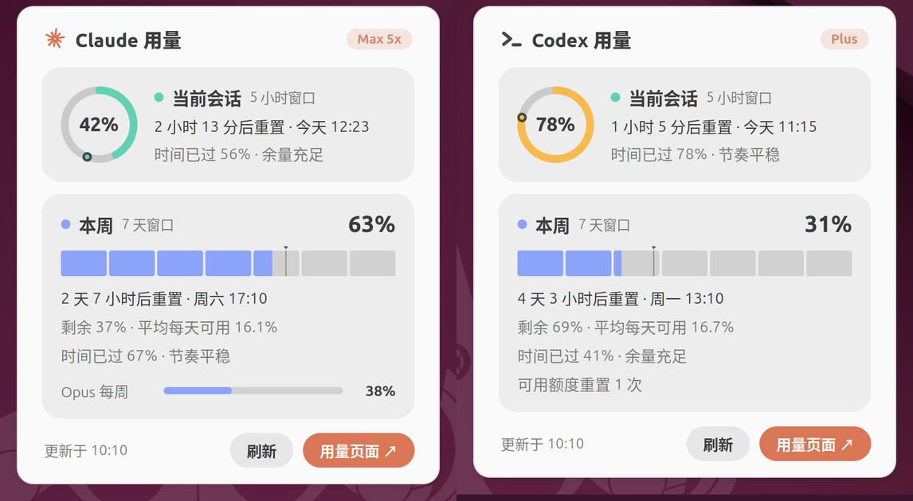

# Claude & Codex Usage

在 Ubuntu（GNOME）顶栏日期右侧，实时显示 **Claude** 和 **Codex** 订阅的 5 小时额度与每周额度。




## 一键安装

```bash
curl -fsSL https://raw.githubusercontent.com/SuKiWSN/claude-codex-usage/main/install.sh | bash
```

安装完成后**注销并重新登录**（Wayland 下 GNOME Shell 只在登录时加载新扩展；X11 下也可以按 Alt+F2 输入 `r` 回车）。

也可以先克隆再安装：

```bash
git clone https://github.com/SuKiWSN/claude-codex-usage.git
cd claude-codex-usage
./install.sh
```

再次运行同一条命令即可升级。

### 要求

- Ubuntu 23.10 / 24.04 或更新版本，默认 GNOME 桌面（GNOME Shell 45–48，更新的版本会尝试安装）
- 要显示 Claude：安装 [Claude Code](https://claude.com/claude-code) 并用 Claude 订阅账号登录（运行一次 `claude`）。之后登录令牌由扩展自动续期，不用再手动打开 `claude`
- 要显示 Codex：安装 Codex CLI（`npm install -g @openai/codex`）并用 ChatGPT 账号登录（`codex login`）

两者只装了一个也没关系：没有安装或没有登录的那一个不会出现在顶栏，装好之后会自动出现。

## 怎么看

```
Oct 15 10:10   ✳ ◔ 42%  ▮▮▮▮▯▯▯ 63%     >_ ◔ 78%  ▮▮▯▯▯▯▯ 31%
               └──── Claude ──────┘       └──── Codex ──────┘
```

| 标识 | 含义 |
| --- | --- |
| ◔ 圆环 | 5 小时滚动窗口的用量，从 12 点方向顺时针填充 |
| ▮ 7 根竖条 | 每周额度，每根约等于一天的平均份额 |
| 颜色 | 5 小时为薄荷绿、每周为长春花蓝；≥75% 变琥珀色，≥90% 变红色 |

点击图标打开详情面板：

- 重置倒计时和具体重置时间
- 时间进度标记（圆环上的圆点 / 格子上方的 ▾），并提示"消耗偏快 / 节奏平稳 / 余量充足"
- 剩余额度和"平均每天可用"
- 按模型的单独额度（例如 Opus 每周），Codex 的可用额度重置次数和 Credits 余额（如果有）
- "刷新"和"用量页面"按钮（分别打开 claude.ai 和 chatgpt.com 的用量页）

面板跟随系统的浅色 / 深色主题。数据每 4 分钟刷新一次，窗口重置后立即刷新，出错时自动退避重试。

## 数据来源与隐私

所有请求都直接从你的电脑发往 Anthropic / OpenAI，不经过任何第三方。

- **Claude**：读取 Claude Code 保存在 `~/.claude/.credentials.json` 中的登录令牌，请求 Claude Code `/usage` 使用的接口。扩展只读取、从不改写该文件。
  - 令牌每隔几个小时就会过期。快过期时，扩展会在后台运行一次 `claude -p /cost`，由 Claude Code 自己续期并写回令牌（和你打开 `claude` 时的效果一样，多个 Claude Code 同时运行也不会冲突）。
  - `/cost` 是本地命令：不调用模型、不消耗额度。运行时还关闭了 hooks、MCP 服务器、遥测和自动更新，也不保存会话记录。
  - 续期失败时，最多每 10 分钟重试一次。
- **Codex**：每次刷新时短暂启动 `codex app-server`，通过其 JSON-RPC 接口调用 `account/rateLimits/read`，拿到结果后立即退出。登录和令牌刷新由 Codex CLI 自己处理，扩展不读取 `~/.codex/auth.json`。会优先使用用户级安装的 `codex`（nvm、`~/.local/bin` 等，即终端里实际运行的那个），snap 版排在最后。
- 最近一次结果缓存在 `~/.cache/claude-usage-indicator/`，登录后可立即显示。

> Claude 的用量接口没有公开文档，将来可能变化。本项目与 Anthropic、OpenAI 无关。

## 卸载

```bash
curl -fsSL https://raw.githubusercontent.com/SuKiWSN/claude-codex-usage/main/install.sh | bash -s -- --uninstall
```

在克隆的目录里也可以运行 `./install.sh --uninstall`。加上 `--purge` 会同时删除缓存。

## 排查问题

面板顶部的红色提示会说明原因，详细日志可以这样看：

```bash
journalctl --user -b -o cat /usr/bin/gnome-shell | grep claude-usage
```

| 提示 | 处理 |
| --- | --- |
| 登录令牌已过期且自动续期没有成功 | 运行一次 `claude`（提示登录就执行 `/login`），扩展会自动恢复。也可以检查扩展能否找到 `claude` 命令：nvm、`~/.local/bin` 等常见位置都会查找 |
| Codex 未登录 | 运行 `codex login` |
| 无法连接 chatgpt.com / api.anthropic.com | 网络或代理问题，此时 `codex` / `claude` 本身也用不了。用 `curl -I https://chatgpt.com` 测试；用 Clash 等代理时检查该域名走的节点。恢复后自动更新，期间显示上次的数据 |
| Codex 返回错误 | 多半是 `codex` 版本太旧，升级：`npm install -g @openai/codex` |
| 装完后顶栏没变化 | 确认已注销重新登录；检查 `gnome-extensions info claude-usage@claude-toolkit` |

## 开发

```bash
./install.sh --dev    # 用软链接安装当前仓库，改完代码重新登录即可生效
```

扩展代码在 [`claude-usage@claude-toolkit/`](claude-usage@claude-toolkit/)：`extension.js`（数据获取与界面）、`stylesheet.css`、`metadata.json`。
